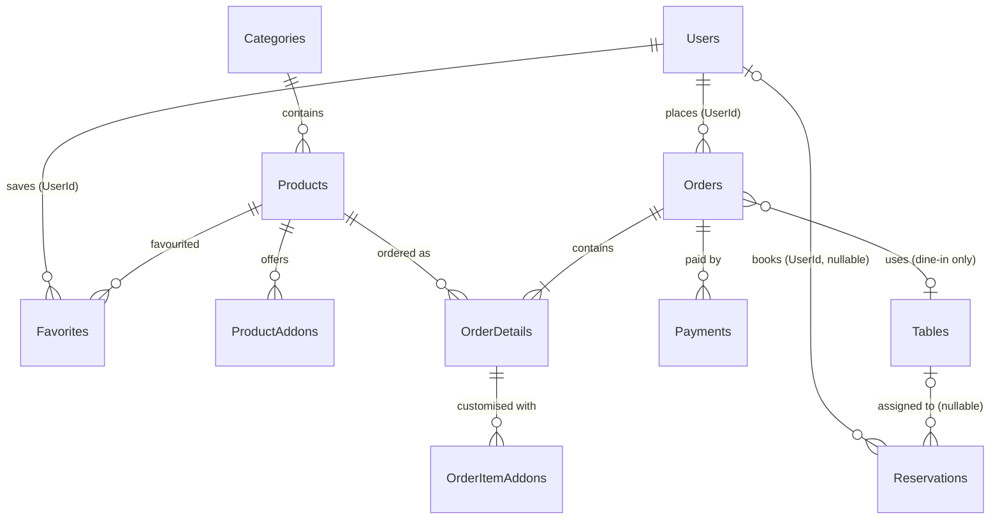

# database.md — RestaurantSystemDB

Reference for the SQL Server LocalDB database that ships with **RestaurantSystem-Final**.
Everything below was read directly from the live database (not from the code) on 2026-11-27.

---

## 1. Overview

| Property | Value |
| --- | --- |
| Engine | SQL Server Express LocalDB **17.0.4025.3** (RTM, 64-bit) |
| Instance | `(localdb)\MSSQLLocalDB` |
| Database name | `RestaurantSystemDB` |
| Files | `RestaurantSystem\DB.mdf` + `DB_log.ldf` (~8 MB each) |
| Attachment | `AttachDbFilename=\|DataDirectory|\DB.mdf` — re-attaches wherever the project sits |
| Compatibility level | 170 |
| Collation | `SQL_Latin1_General_CP1_CI_AS` (case-insensitive) |
| Recovery model | SIMPLE |
| Tables | **12** (11 domain + `__EFMigrationsHistory`) |
| Total rows | 97 |

Connection string (`appsettings.json`):

```
Server=(localdb)\mssqllocaldb;AttachDbFilename=|DataDirectory|\DB.mdf;Database=RestaurantSystemDB;Trusted_Connection=True;MultipleActiveResultSets=true
```

`Program.cs` sets `DataDirectory` to the **content root**, so the database always resolves to
`<project folder>\DB.mdf` regardless of the working directory the app is launched from.

---

## 2. Table inventory

| Table | Rows | Purpose |
| --- | ---: | --- |
| `Users` | 4 | Customer + administrator accounts |
| `Categories` | 5 | Menu sections |
| `Products` | 45 | Menu items (44 active) |
| `ProductAddons` | 4 | Customisation options per dish |
| `Tables` | 10 | Physical restaurant tables |
| `Orders` | 7 | Placed orders (header + totals) |
| `OrderDetails` | 9 | Order line items |
| `OrderItemAddons` | 0 | Add-on snapshots per order line |
| `Payments` | 7 | Payment transactions |
| `Reservations` | 0 | Table bookings |
| `Favorites` | 1 | Saved dishes per user |
| `__EFMigrationsHistory` | 5 | Applied EF Core migrations |

---

## 3. Entity-relationship diagram



Cardinality notes: `||` = exactly one, `}o` = zero or more, `|o` = zero or one. `Orders → Tables` and
`Reservations → Tables`/`Users` are optional links, which is why their optional-side symbols are used.

---

## 4. Tables in detail

### 4.1 `Users` — accounts (3 rows)

| Column | Type | Null | Key / Default | Notes |
| --- | --- | --- | --- | --- |
| `UserId` | int | NO | **PK**, identity | |
| `Username` | nvarchar(50) | NO | **UNIQUE** | Login identifier |
| `Email` | nvarchar(100) | NO | **UNIQUE** | Password-recovery target |
| `Password` | nvarchar(100) | NO | | **PBKDF2 hash** (`PasswordHasher<object>`), not plaintext |
| `FullName` | nvarchar(100) | NO | | |
| `PhoneNumber` | nvarchar(20) | YES | | |
| `Role` | nvarchar(20) | NO | `'MEMBER'` | `ADMIN` or `MEMBER` |
| `PasswordResetToken` | nvarchar(200) | YES | | 256-bit hex, cleared on use |
| `PasswordResetTokenExpiry` | datetime2 | YES | | 30-minute window |
| `ProfilePhotoUrl` | nvarchar(250) | YES | | `/images/avatars/...` |
| `IsBlocked` | bit | NO | `0` | Admin can block MEMBER accounts only |
| `Address` | nvarchar(250) | YES | | Saved delivery address |

**Current data**

| UserId | Username | Role | Blocked | Photo | Address |
| ---: | --- | --- | --- | --- | --- |
| 13 | `admin01` | ADMIN | no | `/images/avatars/user_13.jpg` | — |
| 14 | `user01` | MEMBER | no | — | — |
| 16 | `theuser` | MEMBER | no | — | `No 67, Island Jefry Epstein` |
| 20 | `Khoo` | MEMBER | no | `/images/avatars/user_20.jpg` | `No 67, Jalan ASDF` |

> `UserId` 15, 17 and 18–19 do not exist — they were consumed by test accounts that were later deleted.
> The next account created will be `UserId` 21.

### 4.2 `Categories` — menu sections (5 rows)

| Column | Type | Null | Key / Default |
| --- | --- | --- | --- |
| `CategoryId` | int | NO | **PK**, identity |
| `CategoryName` | nvarchar(50) | NO | **UNIQUE** |

| CategoryId | CategoryName | Items | Active | Source |
| ---: | --- | ---: | ---: | --- |
| 1 | Main Course | 13 | 13 | original + CSV import |
| 2 | Snacks | 11 | 11 | original + CSV import |
| 3 | Drinks | 9 | 8 | original + merged CSV import |
| 4 | Desserts | 3 | 3 | original |
| 5 | Noodles & Pasta | 9 | 9 | CSV import |

> `CategoryId` 6 (`Beverages`) previously existed as a separate CSV-imported category. Its 5 drinks were
> moved into **Drinks** (id 3) and the category was deleted, leaving one merged drinks section.
> `CategoryId` is an identity column, so the next category created will be **7** — id 6 stays unused.

### 4.3 `Products` — menu items (45 rows)

| Column | Type | Null | Key / Default | Notes |
| --- | --- | --- | --- | --- |
| `ProductId` | int | NO | **PK**, identity | |
| `ProductName` | nvarchar(100) | NO | | Not unique at DB level |
| `Description` | nvarchar(500) | YES | | |
| `Price` | decimal(18,2) | NO | | Range RM 1.50 – 24.90 |
| `ImageUrl` | nvarchar(250) | YES | | **Nullable on purpose** (upload arrives as `IFormFile`) |
| `CategoryId` | int | NO | **FK → Categories** | |
| `StockQuantity` | int | NO | `50` | Decremented when an order is placed |
| `IsActive` | bit | NO | `1` | `0` hides the dish from the customer menu |

**Statistics:** 45 total · 44 active · price min RM 1.50, max RM 24.90, average RM 9.17 ·
1 out of stock · stock range 0–100.

Notable rows:

| ProductId | ProductName | Stock | IsActive | Note |
| ---: | --- | ---: | --- | --- |
| 29 | Garlic Bread | 5 | 1 | Low stock |
| 30 | Signature Milk Tea | 0 | 1 | **Out of stock** (still visible) |
| 74 | Mineral Water | 50 | 0 | **Inactive** — `is_available=0` in the import CSV |

### 4.4 `ProductAddons` — customisation options (4 rows)

| Column | Type | Null | Key / Default |
| --- | --- | --- | --- |
| `AddonId` | int | NO | **PK**, identity |
| `ProductId` | int | NO | **FK → Products** (CASCADE) |
| `Name` | nvarchar(100) | NO | |
| `Price` | decimal(18,2) | NO | |
| `IsActive` | bit | NO | |

| AddonId | Dish | Add-on | Price |
| ---: | --- | --- | ---: |
| 1 | Classic Beef Burger | Extra Cheese | RM 2.00 |
| 2 | Classic Beef Burger | Bacon Strips | RM 3.50 |
| 3 | Classic Beef Burger | No Onions | RM 0.00 |
| 4 | Grilled Chicken Pasta | Extra Parmesan | RM 2.50 |

### 4.5 `Tables` — physical tables (10 rows)

| Column | Type | Null | Key / Default |
| --- | --- | --- | --- |
| `TableId` | int | NO | **PK**, identity |
| `TableName` | nvarchar(20) | NO | **UNIQUE** |
| `IsOccupied` | bit | NO | `0` — legacy flag, kept in sync |
| `Capacity` | int | NO | `4` |
| `Location` | nvarchar(50) | YES | |
| `Status` | nvarchar(20) | NO | `'Available'` |

All 10 tables are `Table 1`…`Table 10`, capacity 4, location `NULL`, status **Available**, `IsOccupied = 0`.

> `IsOccupied` is legacy. `Table.SetStatus(...)` in the code is the only writer and keeps both fields
> consistent — a query direct against `IsOccupied` alone can drift.

### 4.6 `Orders` — order headers (7 rows)

| Column | Type | Null | Key / Default | Notes |
| --- | --- | --- | --- | --- |
| `OrderId` | int | NO | **PK**, identity | |
| `UserId` | int | NO | **FK → Users** | |
| `TableId` | int | YES | **FK → Tables** | `NULL` for takeaway/delivery |
| `OrderDate` | **datetime** | NO | `getdate()` | ⚠️ `datetime`, not `datetime2` |
| `TotalAmount` | decimal(18,2) | NO | | Grand total |
| `OrderStatus` | nvarchar(20) | NO | `'PENDING'` | Lifecycle value |
| `DiningOption` | nvarchar(20) | YES | | `DineIn` / `Takeaway` / `Delivery` |
| `PaymentMethod` | nvarchar(30) | YES | | `Cash` / `EWallet` |
| `DeliveryAddress` | nvarchar(250) | YES | | Per-order snapshot |
| `CancellationReason` | nvarchar(250) | YES | | |
| `DeliveryFee` | decimal(18,2) | NO | `0` | |
| `DiscountAmount` | decimal(18,2) | NO | `0` | Reserved for promotions |
| `ServiceCharge` | decimal(18,2) | NO | `0` | Dine-in only |
| `StatusUpdatedDate` | datetime2 | YES | | |
| `SubtotalAmount` | decimal(18,2) | NO | `0` | |
| `TaxAmount` | decimal(18,2) | NO | `0` | |

**Current data**

| OrderId | User | Table | Date | Subtotal | Service | Tax | Delivery | Total | Status | Type | Payment |
| ---: | --- | --- | --- | ---: | ---: | ---: | ---: | ---: | --- | --- | --- |
| 14 | theuser | Table 1 | 2026-09-10 02:32 | 17.80 | 0.00 | 0.00 | 0.00 | **17.80** | `COMPLETED` | DineIn | Cash |
| 15 | theuser | — | 2026-09-10 02:32 | 13.50 | 0.00 | 0.00 | 0.00 | **13.50** | `COMPLETED` | Takeaway | EWallet |
| 20 | Khoo | Table 1 | 2026-11-27 22:16 | 11.90 | 1.19 | 0.79 | 0.00 | **13.88** | `CANCELLED` | DineIn | Cash |
| 21 | Khoo | — | 2026-11-27 22:16 | 6.90 | 0.00 | 0.41 | 0.00 | **7.31** | `CANCELLED` | Takeaway | Card |
| 22 | Khoo | — | 2026-11-27 22:17 | 3.00 | 0.00 | 0.18 | 5.00 | **8.18** | `CANCELLED` | Delivery | EWallet |
| 23 | Khoo | Table 1 | 2026-11-27 22:25 | 11.90 | 1.19 | 0.79 | 0.00 | **13.88** | `COMPLETED` | DineIn | Cash |
| 24 | Khoo | Table 2 | 2026-11-27 22:28 | 11.90 | 1.19 | 0.79 | 0.00 | **13.88** | `COMPLETED` | DineIn | Cash |

> Orders **14** and **15** were seeded by the `Phase2Core` migration backfill, which set
> `SubtotalAmount = TotalAmount` and left tax/service at `0`.
>
> Orders **20–24** were placed through the UI and show the real breakdown. They confirm the pricing
> rules: order 20 is dine-in, so it carries a 10 % service charge (11.90 × 10 % = 1.19) with 6 % tax on
> subtotal + service (13.09 × 6 % = 0.79) = **13.88**. Order 22 is delivery, so it has no service charge
> but adds the RM 5.00 delivery fee.

### 4.7 `OrderDetails` — order lines (9 rows)

| Column | Type | Null | Key / Default |
| --- | --- | --- | --- |
| `OrderDetailId` | int | NO | **PK**, identity |
| `OrderId` | int | NO | **FK → Orders** (CASCADE) |
| `ProductId` | int | NO | **FK → Products** (NO_ACTION) |
| `Quantity` | int | NO | |
| `PriceAtOrder` | decimal(18,2) | NO | Price snapshot at purchase time |
| `SpecialInstructions` | nvarchar(200) | YES | e.g. "no onions" |

| DetailId | Order | Product | Qty | Price |
| ---: | ---: | --- | ---: | ---: |
| 21 | 14 | Classic Beef Burger | 1 | 12.90 |
| 22 | 14 | Crispy French Fries | 1 | 4.90 |
| 23 | 15 | Chocolate Lava Cake | 1 | 7.50 |
| 24 | 15 | Fresh Orange Juice | 1 | 6.00 |
| 29 | 20 | Aglio Olio Spaghetti | 1 | 11.90 |
| 30 | 21 | BBQ Chicken Wings | 1 | 6.90 |
| 31 | 22 | Iced Lemon Tea | 1 | 3.00 |
| 32 | 23 | Aglio Olio Spaghetti | 1 | 11.90 |
| 33 | 24 | Aglio Olio Spaghetti | 1 | 11.90 |

> Detail ids 25–28 are missing — they belonged to orders that were deleted during testing.
> No line currently carries `SpecialInstructions`.

### 4.8 `OrderItemAddons` — add-on snapshots (0 rows)

| Column | Type | Null | Key |
| --- | --- | --- | --- |
| `OrderItemAddonId` | int | NO | **PK**, identity |
| `OrderDetailId` | int | NO | **FK → OrderDetails** (CASCADE) |
| `Name` | nvarchar(100) | NO | |
| `PriceAtOrder` | decimal(18,2) | NO | Snapshot — later edits to `ProductAddons` never rewrite history |

Empty: no order placed so far has used an add-on.

### 4.9 `Payments` — transactions (7 rows)

| Column | Type | Null | Key / Default |
| --- | --- | --- | --- |
| `PaymentId` | int | NO | **PK**, identity |
| `OrderId` | int | NO | **FK → Orders** |
| `Method` | nvarchar(30) | YES | `Cash` / `EWallet` / `Card` |
| `Amount` | decimal(18,2) | NO | |
| `Status` | nvarchar(20) | NO | `PAID` / `UNPAID` / `REFUNDED` |
| `Reference` | nvarchar(50) | YES | |
| `CreatedDate` | datetime2 | NO | |
| `PaidDate` | datetime2 | YES | `NULL` while unpaid |

| PaymentId | Order | Method | Amount | Status | Reference |
| ---: | ---: | --- | ---: | --- | --- |
| 1 | 14 | Cash | 17.80 | PAID | `LEGACY-14` |
| 2 | 15 | EWallet | 13.50 | PAID | `LEGACY-15` |
| 7 | 20 | Cash | 13.88 | UNPAID | `ORD-20-20261127221602` |
| 8 | 21 | Card | 7.31 | REFUNDED | `ORD-21-20261127221631` |
| 9 | 22 | EWallet | 8.18 | REFUNDED | `ORD-22-20261127221755` |
| 10 | 23 | Cash | 13.88 | PAID | `ORD-23-20261127222558` |
| 11 | 24 | Cash | 13.88 | PAID | `ORD-24-20261127222817` |

> Rows 1–2 (`LEGACY-*`) were created by the migration backfill. Rows 7–11 were created by the app and
> show the real settlement lifecycle:
> - **Cash** starts `UNPAID` and becomes `PAID` when the order is completed (payment 7 is still unpaid
>   because its order was never completed).
> - **EWallet / Card** are `PAID` immediately.
> - A **cancelled** order that was already paid flips to `REFUNDED` (payments 8 and 9).
>
> `PaymentId` 3–6 are missing — they belonged to orders that were deleted during testing.

> ⚠️ **`Card` exists in the data and in the payment form, but not in `Models/Statuses.cs`.**
> `Payment.cshtml` offers three options (Cash, Card, EWallet), and `CreateOrder` treats anything that is
> not `Cash` as paid immediately — so `Card` behaves correctly. However the `PaymentMethod` constants
> class still lists only `{ Cash, EWallet }`. Adding `Card` there would keep the code honest; nothing is
> currently broken because no validation consults that array.

### 4.10 `Reservations` — table bookings (0 rows)

| Column | Type | Null | Key / Default |
| --- | --- | --- | --- |
| `ReservationId` | int | NO | **PK**, identity |
| `UserId` | int | YES | `NULL` = walk-in booking taken at the counter |
| `CustomerName` | nvarchar(100) | NO | |
| `Phone` | nvarchar(20) | NO | |
| `Email` | nvarchar(100) | YES | |
| `ReservationDate` | datetime2 | NO | Date part only |
| `ReservationTime` | **time** | NO | Time part |
| `Guests` | int | NO | |
| `TableId` | int | YES | **FK → Tables** (`SET_NULL`) |
| `Status` | nvarchar(20) | NO | `PENDING`/`CONFIRMED`/`CANCELLED`/`REJECTED`/`COMPLETED` |
| `SpecialRequests` | nvarchar(250) | YES | |
| `CreatedDate` | datetime2 | NO | |

Empty. A booking occupies its table for **120 minutes** (`Reservation.DurationMinutes`), and overlap is
prevented in code — there is **no DB-level exclusion constraint**.

### 4.11 `Favorites` — saved dishes (1 row)

| Column | Type | Null | Key / Default |
| --- | --- | --- | --- |
| `FavoriteId` | int | NO | **PK**, identity |
| `UserId` | int | NO | **FK → Users** (CASCADE) |
| `ProductId` | int | NO | **FK → Products** (CASCADE) |
| `AddedDate` | datetime2 | NO | `getdate()` |

| FavoriteId | User | Dish | Added |
| ---: | --- | --- | --- |
| 14 | Khoo | Aglio Olio Spaghetti | 2026-11-27 22:15 |

Protected by **unique index** `UQ_Favorites_User_Product (UserId, ProductId)` — a user cannot favourite
the same dish twice.

### 4.12 `__EFMigrationsHistory` (5 rows)

| MigrationId | Purpose |
| --- | --- |
| `20260708123322_CreateDB` | Initial schema |
| `20260715140421_UpdateDB` | Reworked Users/Tables/Orders, dropped most FKs + FK indexes |
| `20260830033453_UpdateDBv1` | Reset token, `ProfilePhotoUrl`, `StockQuantity`, `DiningOption`, `PaymentMethod`, `Favorites` |
| `20261127081948_SyncModelWithDb` | Idempotent reconciliation with the out-of-band-edited DB |
| `20261127082133_Phase2Core` | Reservations, Payments, add-ons, order lifecycle, price breakdown, table status |

`dotnet ef migrations has-pending-model-changes` → **"No changes"**: model and database agree.

---

## 5. Indexes

| Table | Index | Unique | Columns |
| --- | --- | --- | --- |
| Categories | `UQ__Categori__…` | ✔ | `CategoryName` |
| Favorites | `IX_Favorites_UserId` | | `UserId` |
| Favorites | `UQ_Favorites_User_Product` | ✔ | `UserId, ProductId` |
| OrderItemAddons | `IX_OrderItemAddons_OrderDetailId` | | `OrderDetailId` |
| Orders | `IX_Orders_UserId` | | `UserId` |
| Payments | `IX_Payments_OrderId` | | `OrderId` |
| ProductAddons | `IX_ProductAddons_ProductId` | | `ProductId` |
| Products | `IX_Products_CategoryId` | | `CategoryId` |
| Reservations | `IX_Reservations_TableId_ReservationDate` | | `TableId, ReservationDate` |
| Tables | `UQ__Tables__…` | ✔ | `TableName` |
| Users | `UQ__Users__536C85E4…` | ✔ | `Username` |
| Users | `UQ__Users__A9D10534…` | ✔ | `Email` |

12 indexes exist on the application tables. (The catalog also reports ~194 further indexes belonging to
SQL Server internals — full-text, queue and agent tables — which are not part of this schema and are
hidden when you filter by user table.)

---

## 6. Foreign keys

| Parent | Column | → Referenced | On delete |
| --- | --- | --- | --- |
| `Favorites` | `ProductId` | `Products.ProductId` | CASCADE |
| `Favorites` | `UserId` | `Users.UserId` | CASCADE |
| `OrderDetails` | `OrderId` | `Orders.OrderId` | CASCADE |
| `OrderDetails` | `ProductId` | `Products.ProductId` | NO ACTION |
| `OrderItemAddons` | `OrderDetailId` | `OrderDetails.OrderDetailId` | CASCADE |
| `Orders` | `TableId` | `Tables.TableId` | NO ACTION |
| `Orders` | `UserId` | `Users.UserId` | NO ACTION |
| `ProductAddons` | `ProductId` | `Products.ProductId` | CASCADE |
| `Products` | `CategoryId` | `Categories.CategoryId` | CASCADE |
| `Reservations` | `TableId` | `Tables.TableId` | SET NULL |

> ⚠️ **Two duplicate foreign keys exist** (harmless but worth knowing before writing schema tooling):
> - `Orders.UserId` has both `FK__Orders__UserId__00200768` and `FK_Orders_Users_UserId`
> - `Products.CategoryId` has both `FK__Products__Catego__7B5B524B` (CASCADE) and
>   `FK_Products_Categories_CategoryId` (NO ACTION)
>
> The system-named ones date from the original `CreateDB` migration (2026-07-12); the EF-named ones were
> added by `Phase2Core` (2026-11-27). Because the DB was edited out-of-band at some point, SQL Server
> never dropped the originals.

---

## 7. Enumerated values

These are stored as plain `nvarchar` — **no `CHECK` constraints exist**, so validity is enforced by the
application only (`Models/Statuses.cs`).

| Column | Allowed values | Used today |
| --- | --- | --- |
| `Users.Role` | `ADMIN`, `MEMBER` | ADMIN ×1, MEMBER ×3 |
| `Orders.OrderStatus` | `PENDING`, `CONFIRMED`, `PREPARING`, `READY`, `COMPLETED`, `CANCELLED` | COMPLETED ×4, CANCELLED ×3 |
| `Orders.DiningOption` | `DineIn`, `Takeaway`, `Delivery` | DineIn ×4, Takeaway ×2, Delivery ×1 |
| `Orders.PaymentMethod` / `Payments.Method` | `Cash`, `EWallet`, **`Card`** | Cash ×4, EWallet ×2, Card ×1 |
| `Payments.Status` | `PAID`, `UNPAID`, `REFUNDED` | PAID ×4, UNPAID ×1, REFUNDED ×2 |
| `Tables.Status` | `Available`, `Reserved`, `Occupied`, `Cleaning`, `Unavailable` | Available ×10 |
| `Reservations.Status` | `PENDING`, `CONFIRMED`, `CANCELLED`, `REJECTED`, `COMPLETED` | — |

> `Card` is accepted by the payment form and stored in the data, but is **not** listed in
> `PaymentMethod.All` in `Models/Statuses.cs` (see §4.9).

Legal order transitions (`OrderStatus.CanTransition`):

```
PENDING → CONFIRMED → PREPARING → READY → COMPLETED
PENDING / CONFIRMED / PREPARING → CANCELLED
```

---

## 8. Business rules encoded in data

| Rule | Where enforced |
| --- | --- |
| Prices are snapshotted at purchase (`PriceAtOrder`, `OrderItemAddons.PriceAtOrder`) | Application |
| `TotalAmount = Subtotal + ServiceCharge + Tax + DeliveryFee − Discount` | Application (`Pricing.Calculate`) |
| Stock decremented on order creation, restored on cancellation | Application |
| Dine-in requires an available table; table state follows the order | Application |
| One table can't hold two overlapping active reservations | Application |
| Username / Email / TableName / CategoryName unique | **Database** |
| A user can favourite a dish only once | **Database** |
| Cannot delete a category that still has products | Application + `NO ACTION` FK |

---

## 9. Integrity audit (all clean)

| Check | Result |
| --- | --- |
| Orphan `OrderDetails` | 0 |
| Orphan `Payments` | 0 |
| Orders referencing a missing user | 0 |
| Orders referencing a missing table | 0 |
| Products referencing a missing category | 0 |
| `Order.TotalAmount` ≠ sum of components | 0 |
| `Order.SubtotalAmount` ≠ sum of its detail lines | 0 |
| `Tables.IsOccupied` out of sync with `Status` | 0 |
| `Payment.Amount` ≠ order total | 0 |
| Orders with an invalid status value | 0 |
| Reservations referencing a missing table | 0 |

Image references: **47 URLs, 0 dangling** — every `Products.ImageUrl` and `Users.ProfilePhotoUrl`
resolves to a real file under `wwwroot`.

Unreferenced files under `wwwroot/images` (harmless leftovers):

| File | Reason |
| --- | --- |
| `46_Dulcera.png` | Never used |
| `restaurant-bg.jpg` | Used via CSS, not DB |
| `avatars/default-avatar.png` | Fallback avatar |
| `avatars/user_4.png` | Orphan from a deleted user |
| `menu/Fresh_Orange_Juice.jpg` | CSV duplicate skipped (existing item kept) |
| `menu/Garlic_Bread.jpg` | CSV duplicate skipped (existing item kept) |

---

## 10. Known quirks

1. **`Orders.OrderDate` is `datetime`, not `datetime2`.** All other dates are `datetime2`. `datetime` has
   ~3.33 ms precision and a narrower range; harmless here but do not assume `datetime2` when scripting
   date comparisons against this column.
2. **Duplicate foreign keys** on `Orders.UserId` and `Products.CategoryId` (§6).
3. **`Tables.IsOccupied` is redundant** with `Tables.Status`; it survives only for backwards compatibility
   and is kept in sync by `Table.SetStatus(...)`. Update status through the application, not raw SQL.
4. **No `CHECK` constraints** on any status column (§7).
5. **`Product.ImageUrl` is nullable** by design — the admin form posts an `IFormFile`, so the text column
   is empty at model-binding time.
6. **Seeded order totals have zero tax/service.** Orders 14 and 15 came from a backfill that copied
   `TotalAmount` into `SubtotalAmount`; only orders placed through the UI carry a full breakdown.
7. **Sparse identity values** — `UserId` runs 13–20 with gaps at 15, 17, 18 and 19; `ProductId` runs
   23–76 with a single gap at `36 → 46`; `OrderId` runs 14, 15 then 20–24; `PaymentId` skips 3–6;
   `OrderDetailId` skips 25–28. All gaps are from records deleted during testing. Nothing depends on
   contiguity, but don't assume sequential IDs in fixtures.
8. **`Products.ProductName` is not unique at DB level**, which is why the CSV import produced near-duplicates
   in the *source* data (the two colliding rows were skipped instead).
9. **`Card` is accepted by the UI but missing from `PaymentMethod.All`** (§4.9, §7).

---

## 11. Working with the database

**Browse it:** Visual Studio → *SQL Server Object Explorer* → `(localdb)\MSSQLLocalDB` → `RestaurantSystemDB`.

**Query from the shell:**

```powershell
sqlcmd -S "(localdb)\MSSQLLocalDB" -d RestaurantSystemDB -Q "SELECT COUNT(*) FROM Products" -W
```

**Ensure it is running / attached:**

```powershell
sqllocaldb info MSSQLLocalDB        # check State: Started
sqllocaldb start MSSQLLocalDB
```

**Back up** — copy `DB.mdf` **and** `DB_log.ldf` together while the app is stopped:

```powershell
Copy-Item RestaurantSystem\DB.mdf, RestaurantSystem\DB_log.ldf RestaurantSystem\App_Data\backup-<date>\ -Force
```

> A snapshot taken before the Phase 2 migration lives in `RestaurantSystem/App_Data/backup-20261127/`.

**Migrate** (see `Agent.md` §9 for the full procedure):

```powershell
dotnet ef migrations add <Name> && dotnet ef database update
```

### 🚫 Destructive commands — do not run

- **`DROP DATABASE [RestaurantSystemDB]`** — for an attached `.mdf` this **deletes `DB.mdf` and
  `DB_log.ldf` from disk**. There is no recycle bin and no git.
  To detach safely:
  ```sql
  USE master;
  ALTER DATABASE [RestaurantSystemDB] SET SINGLE_USER WITH ROLLBACK IMMEDIATE;
  EXEC sp_detach_db 'RestaurantSystemDB';
  ```
- **`dotnet ef migrations remove`** — deletes migration files and rewrites the snapshot with no undo.

---

## 12. Quick reference

| Thing | Value |
| --- | --- |
| Server | `(localdb)\MSSQLLocalDB` |
| Database | `RestaurantSystemDB` |
| Files | `DB.mdf`, `DB_log.ldf` (next to the `.csproj`) |
| Tables | 12 |
| Total rows | 97 |
| Next IDs | Product 77 · Order 25 · OrderDetail 34 · Payment 12 · User 21 · Table 25 · Category 7 · Addon 5 · Favorite 15 · Reservation 4 |
| Currency | RM, `decimal(18,2)` |
| Menus | 5 categories, 45 dishes (44 active) |
| Backups | `RestaurantSystem/App_Data/backup-20261127/` |
